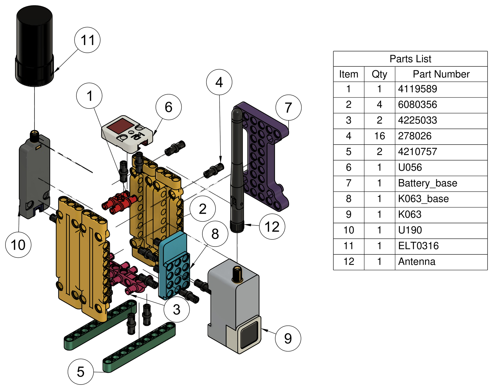
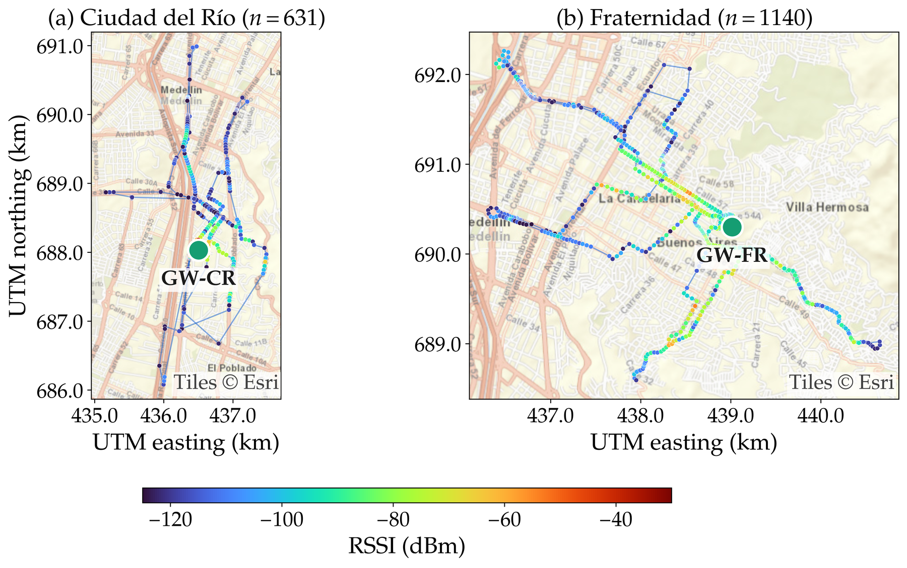
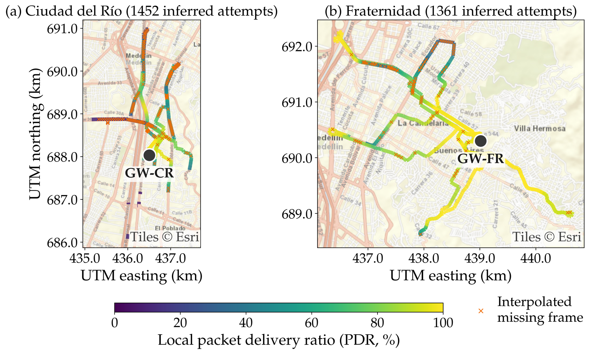

<div align="center">

# LoRaScope

**An open, modular hardware platform for joint LoRaWAN coverage mapping and GNSS positioning-quality assessment**

[](https://github.com/CORIOTLAB/LoRaScope/actions/workflows/ci.yml)
[](LICENSES/MIT.txt)
[](LICENSES/CERN-OHL-P-2.0.txt)
[](LICENSES/CC-BY-4.0.txt)

</div>

This repository is the open-science companion of the article

> J. Botero-Valencia, J. Morales-Guerra, S. Cano-Molina, L. Hernández-Palacio, R. Hernández-García, S. Gutiérrez-Calderon and C. Del-Valle-Soto, "LoRaScope: An Open Modular Hardware Platform for Joint LoRaWAN Coverage Mapping and GNSS Positioning Quality Assessment", *Applied Sciences* (MDPI), 2026. *Manuscript in preparation; the DOI will be added on publication.*

It contains everything needed to inspect, reproduce and extend the work: the firmware and network-server payload decoder, the 3D-printable parts, the six field-campaign datasets, and the scripts that generate the geographic figures of the article.



## What is LoRaScope?

LoRaScope is a portable instrument that sends, in **every LoRaWAN uplink**, a compact 20-byte frame with the GNSS solution, its quality indicators (fix type, satellites used, visible satellites per constellation, PDOP/HDOP/VDOP) and the device orientation (pitch and roll). The network server adds the RSSI and SNR measured by the receiving gateway, so radio quality and positioning conditions are recorded together at each location, under fixed radio settings (SF7, transmit-power index 0, ADR disabled).

| Subsystem | Component |
| --- | --- |
| Processing and display | M5Stack AtomS3 (ESP32-S3) |
| Orientation | M5Stack Unit Accel (ADXL345, SKU U056), I²C |
| LoRaWAN | M5Stack Atom DTU LoRaWAN base, RAK3172 (AU915, sub-band 2) |
| GNSS | M5Stack Unit GPS SMA (SKU U190, ATGM336H) with external SK530 antenna |
| Power | PM1S-16340 charging/step-up module, 16340 Li-ion cell |
| Structure | LEGO Technic elements and two 3D-printed adapters |

## Headline results (as reported in the manuscript)

Six mobile campaigns on a private ChirpStack network in Medellín, Colombia, with two gateways:

| | Ciudad del Río (GW-CR) | Fraternidad (GW-FR) |
| --- | ---: | ---: |
| Received uplinks | 631 | 1140 |
| Packet delivery ratio | 43.5 % | 83.8 % |
| Log-distance slope *n* | 4.25 | 1.54 |

In total, 1771 georeferenced uplinks along a 67.6 km lower-bound path. Distance-adjusted RSSI residuals showed negligible correlation with PDOP (Spearman ρ = −0.085 and −0.012). Whole-device power measured at 5 V was 0.592 W (60 s confirmed-uplink configuration). Please read the article for the limitations of these estimates; the numbers here may change in the published version.

| | |
| --- | --- |
|  |  |

## Repository layout

```
LoRaScope/
├── hardware/           3D-printed parts (STEP and STL) and bill of materials
├── firmware/           Arduino sketch, CORIOT_* libraries and ChirpStack payload decoder
├── data/campaigns/     Six field-campaign datasets (CSV) and their data dictionary
├── analysis/           Scripts that regenerate the maps and GNSS figures
├── docs/               20-byte frame specification and figures used in this README
├── tests/              Decoder round-trip test against the datasets
├── tools/              Dataset integrity check and publication helper
└── LICENSES/           Full license texts (MIT, CERN-OHL-P-2.0, CC-BY-4.0)
```

## Quick start

**1. Build the hardware.** Print the two adapters in [`hardware/cad/`](hardware/README.md) and assemble the parts listed in [`hardware/BOM.csv`](hardware/BOM.csv).

**2. Flash the firmware.** See [`firmware/README.md`](firmware/README.md). In short: install the *M5Unified* and *M5-LoRaWAN-RAK* libraries, copy the `CORIOT_*` libraries from `firmware/libraries/` to your Arduino libraries folder, copy `A152_CONFIG.example.h` to `A152_CONFIG.h`, enter your own ChirpStack keys, and upload `CORIOT_LoRaScope.ino` to an AtomS3.

**3. Decode uplinks.** Paste [`firmware/decoder/decoder.js`](firmware/decoder/decoder.js) as a JavaScript codec in your ChirpStack device profile. The frame is described in [`docs/payload-format.md`](docs/payload-format.md).

**4. Explore the data.** See [`data/README.md`](data/README.md).

**5. Regenerate the figures.**

```bash
pip install -r analysis/requirements.txt
python analysis/regenerate_maps.py
```

Outputs are written to `analysis/output/`. Esri basemap tiles are downloaded on first use; without internet access the maps are drawn without the basemap. See [`analysis/README.md`](analysis/README.md).

## Verify the repository

```bash
python tools/check_data.py        # dataset integrity and numbers quoted in the article
node tests/decoder.test.js        # encodes all 1771 records and decodes them back
```

Both checks run automatically on every push through GitHub Actions.

## Security note

Never commit LoRaWAN credentials. `A152_CONFIG.h` is listed in `.gitignore`; only the placeholder `A152_CONFIG.example.h` is versioned.

## How to cite

Please cite the article and, where relevant, the dataset and firmware release. Machine-readable metadata is provided in [`CITATION.cff`](CITATION.cff); GitHub shows a *Cite this repository* button.

## Licenses

| Content | License |
| --- | --- |
| Firmware, decoder, scripts and tests | [MIT](LICENSES/MIT.txt) |
| Hardware design files (STEP, STL, bill of materials) | [CERN-OHL-P-2.0](LICENSES/CERN-OHL-P-2.0.txt) |
| Datasets and documentation | [CC BY 4.0](LICENSES/CC-BY-4.0.txt) |

Third-party components keep their own licenses: LEGO® Technic elements, M5Stack and RAKwireless products, the *M5Unified* and *M5-LoRaWAN-RAK* libraries, and Esri basemap tiles (© Esri) shown in the figures. LEGO® is a trademark of the LEGO Group, which does not sponsor or endorse this project.

## Funding and acknowledgments

This research received funding from the Sistema General de Regalías (SGR) – Asignación para la Ciencia, Tecnología e Innovación (ACTeI), through the SosAgro4.C project (BPIN code 2024000100094). The authors acknowledge the Grupo de Sistemas de Control y Robótica (COL0123701) of the Institución Universitaria ITM.

## Contact

Corresponding author: Juan Botero-Valencia, Grupo Sistemas de Control y Robótica, Institución Universitaria ITM, Medellín, Colombia. Please use [GitHub Issues](../../issues) for questions about the repository.
