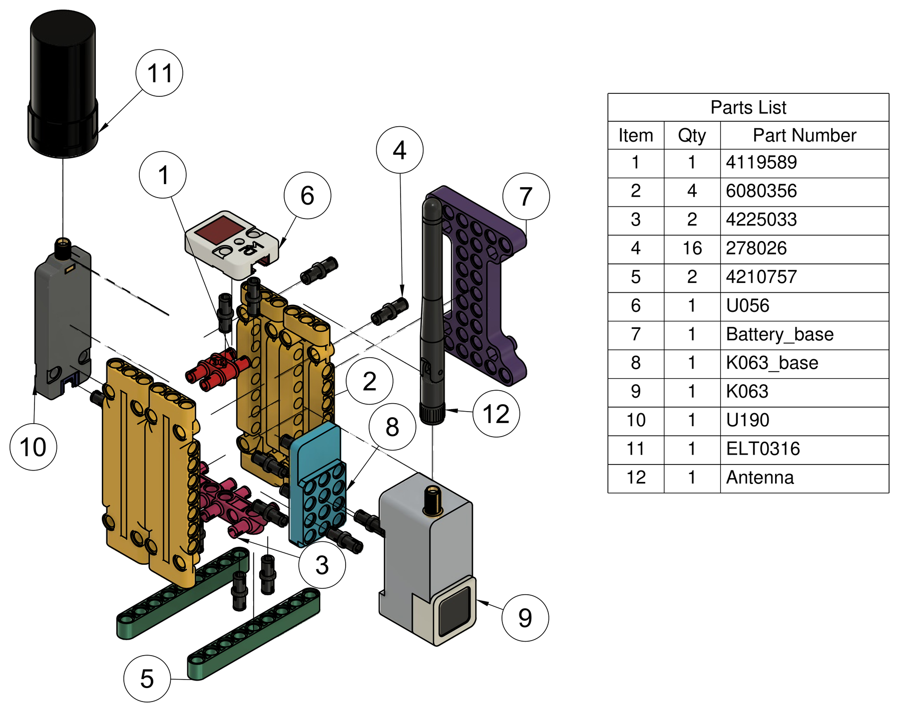

# Hardware

LoRaScope is assembled from commercial modules on a reconfigurable LEGO® Technic
frame. Only two parts are custom: 3D-printed adapters that hold the electronics.

*Exploded view of the assembly (Fig. 1 of the article). Numbers refer to the `item`
column of [`BOM.csv`](BOM.csv).*

## 3D-printed parts

| Part | Item | STEP | STL | Size (mm) | Triangles |
| --- | :-: | --- | --- | --- | ---: |
| `Battery_base` | 7 | [`step/Battery_base.step`](cad/step/Battery_base.step) | [`stl/Battery_base.stl`](cad/stl/Battery_base.stl) | 49.0 × 73.0 × 10.8 | 12 132 |
| `k063_base` | 8 | [`step/k063_base.step`](cad/step/k063_base.step) | [`stl/k063_base.stl`](cad/stl/k063_base.stl) | 8.0 × 24.0 × 50.0 | 6 232 |

- STEP files are the editable, neutral CAD source (AP214); use them to modify the design in any CAD package.
- STL files are binary meshes ready for slicing. Dimensions are in millimetres, consistent with the 8 mm LEGO Technic pitch.
- Print material, layer height and infill are **not yet documented**; add them here once the authors confirm the settings used for the prototype.

## Bill of materials

[`BOM.csv`](BOM.csv) lists the 12 items of the exploded view plus the components of
Table 1 of the article that are not drawn. The `status` column marks entries that
the authors must still confirm (SKU, supplier or description).

## Assembly notes

- The AtomS3 plugs directly onto the Atom DTU LoRaWAN base, which provides the RAK3172 radio, UART link and 915 MHz SMA antenna.
- The GNSS unit (UART) and the ADXL345 accelerometer (I²C) connect to the AtomS3 pins listed in [`firmware/README.md`](../firmware/README.md).
- The PM1S-16340 module supplies 5 V through its USB output to the AtomS3, which in turn powers the communication base and the GNSS unit.
- For comparable coverage maps keep the GNSS antenna with an unobstructed view of the sky, as in the reported campaigns.

## License

Design files and the bill of materials are released under
[CERN-OHL-P-2.0](../LICENSES/CERN-OHL-P-2.0.txt). LEGO® is a trademark of the LEGO
Group, which does not sponsor or endorse this project.
